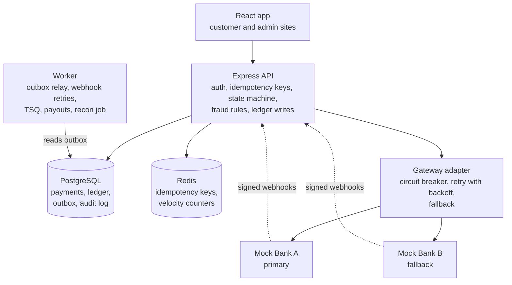

# TransactFlow

A full-stack payment platform. Customers pay and transfer money, and an operations team monitors, reconciles and blocks risky activity. The backend covers one main idea from each of Modules 1 to 11 of the fintech course.

**Live site: <https://transactflow.onrender.com>** (free plan: it sleeps after 15 minutes without a visitor; a [scheduled GitHub job](.github/workflows/keep-alive.yml) asks its health page every 5 minutes to keep it awake, but if it has slept anyway the first page takes about a minute to load).

The build follows the *TransactFlow: Full-Stack Build Spec* (9 Nov 2026) in 11 phases. Each phase starts only after the previous phase's check passes and the owner approves.

**Watch it: [docs/walkthrough.webm](docs/walkthrough.webm)**, a 5-minute captioned walkthrough of all twelve screens (download it to play).

## What it shows

Five hard problems of payments, each one visible on the live site:

- A double-tapped Pay button charges once, not twice.
- A gateway timeout ends in the correct final status, not a guess.
- A failing gateway trips the circuit breaker and traffic moves to a backup bank.
- A nightly reconciliation report shows classified breaks, not a vague "mismatch".
- Every decline shows a clear reason to the customer.

## Architecture

Every call to a bank passes through one adapter with a circuit breaker. Both banks are simulators this project controls, so they can be told to fail on demand.



- The API writes a payment and its ledger entries to PostgreSQL in **one transaction**, so money and its record can never disagree.
- Redis holds only idempotency locks and velocity counters. **Balances are never cached**: every balance is read from PostgreSQL.
- The worker publishes events from the outbox table, asks banks about payments left UNKNOWN (TSQ), retries failed webhooks, sends payout batches and runs reconciliation.
- All money is stored as whole kobo (`BIGINT`), never as a floating-point number.

## Quick start (about five minutes)

You need [Node.js 20 or newer](https://nodejs.org) and [Docker Desktop](https://www.docker.com/products/docker-desktop/) (running).

```bash
git clone https://github.com/Abu-Sumayyah-05/transactflow-api.git && cd transactflow-api
npm install
npm --prefix web install
cp .env.example .env        # then fill it in: see the table below
npm run db:up               # PostgreSQL 16 (port 5433) and Redis 7 (port 6380) in Docker
npm run web:build           # builds the React site into web/dist
npm run demo                # migrations + demo accounts + both banks + API + worker
```

Then open **http://localhost:4000**.

Values to fill in `.env` (everything else already has a working default):

| Setting | What to put |
| --- | --- |
| `POSTGRES_PASSWORD` | Any password. Use the same one inside `DATABASE_URL` and `TEST_DATABASE_URL` (replace `change-me`) |
| `JWT_SECRET` | `node -e "console.log(require('crypto').randomBytes(48).toString('hex'))"` |
| `FIELD_ENCRYPTION_KEY`, `CARD_FINGERPRINT_KEY`, `WEBHOOK_SECRET_A`, `WEBHOOK_SECRET_B`, `SIM_TOKEN` | A different value for each, from `node -e "console.log(require('crypto').randomBytes(32).toString('hex'))"` |
| `DEMO_PASSWORD` | The password the demo accounts sign in with (at least 10 characters) |

### Demo accounts

`npm run demo` (or `npm run seed`) creates these. All four use the password you set in `DEMO_PASSWORD`. Running it again keeps balances and history and only resets the passwords.

| Email | Role | Starts with | Use it for |
| --- | --- | --- | --- |
| `customer@transactflow.demo` | customer | ₦25,000 | Wallet, top up, transfer, history |
| `friend@transactflow.demo` | customer | ₦5,000 | Someone to send money to |
| `merchant@transactflow.demo` | merchant | ₦500,000 | Payouts (CSV upload) |
| `admin@transactflow.demo` | admin | ₦0 | The admin console |

Test card: `4111 1111 1111 1111`, month `12`, year `2030`, CVV `123`. Mock bank accounts for transfers and payouts: `0123456789` (Ngozi Eze), `0987654321` (Funke Adeyemi), `0000000001` (Ibrahim Musa). A ready-made payout file is in [docs/sample-payouts.csv](docs/sample-payouts.csv).

## The 3-minute demo

Use two browser windows side by side: the **customer** in one, the **admin** in a private window (so both stay signed in).

| Time | Do this | What it proves |
| --- | --- | --- |
| 0:00 | **Customer:** sign in. The wallet shows ₦25,000.00. | Balances come straight from the ledger in PostgreSQL. |
| 0:15 | **Customer:** Top up, ₦5,000 with the test card, then **double-click Pay**. Open History: one top-up, not two. | Idempotency: both clicks carry the same key, so the second returns the first one's result. |
| 0:45 | **Admin:** Simulator controls, Mock Bank A, **Timeout**, Apply to Bank A. **Customer:** top up ₦300. The screen says "Confirming…", then settles on the real result. **Admin:** Back to normal. | A timeout is stored as UNKNOWN, never FAILED. The status query (TSQ) asks the bank what really happened. |
| 1:20 | **Admin:** Mock Bank A, What it answers: **Decline with one code**, 51 insufficient funds, Apply. **Customer:** top up ₦100. **Admin:** Back to normal. | The decline classifier turns the bank's code into a plain reason. Never a bare "declined". |
| 1:45 | **Admin:** Mock Bank A, **Error 503**, Apply. **Customer:** top up ₦200, three times. **Admin:** Live dashboard: Bank A's breaker is OPEN and the payments completed on Bank B. Back to normal. | Retries with backoff, then the circuit breaker opens and traffic moves to the fallback bank. |
| 2:20 | **Admin:** Simulator, Mock Bank A, tick **One wrong amount**, Apply. Reconciliation, **Run Bank A**. A break appears, classed AMOUNT MISMATCH, ready to resolve with a note. | Reconciliation classifies each break instead of reporting a vague mismatch. |
| 2:45 | **Admin:** Simulator, tick **Wrong closing balance**, Apply. Reconciliation, Run Bank A. The run is HALTED with the reason. | A statement that does not add up is refused, not half-processed. |

If there is time left: sign in as the merchant and upload [docs/sample-payouts.csv](docs/sample-payouts.csv) on the Payouts screen (two rows pay, one fails name enquiry, one fails the format check), or open the Fraud queue, Webhook log and Dead-letter queue.

## Live deployment (Render)

The live site runs on [Render](https://render.com)'s free plan as three services in one region: the app (built from the [Dockerfile](Dockerfile)), PostgreSQL and Key Value (Render's Redis). The app container runs `scripts/demo.js`, so it applies migrations, creates the demo accounts and starts both mock banks, the API, the site and the background jobs in one process. Render serves it over HTTPS (TLS), which the spec requires.

One process is a demo-sized choice: it fits a single free service. The code does not depend on it. The API, the worker and each bank can run as separate services with the commands under Development.

[render.yaml](render.yaml) is a Render Blueprint: it describes all three services, so nothing is set up by hand except three values Render asks for.

1. Sign in at [dashboard.render.com](https://dashboard.render.com) with the GitHub account that owns the repository.
2. Choose **New**, then **Blueprint**, and pick this repository. Render reads `render.yaml`.
3. Fill in the three values it asks for. Generate the two keys freshly; do not reuse the ones in your local `.env`.

   | Value | What to enter |
   |---|---|
   | `FIELD_ENCRYPTION_KEY` | 64 hex characters: `node -e "console.log(require('crypto').randomBytes(32).toString('hex'))"` |
   | `CARD_FINGERPRINT_KEY` | Run the same command again for a second, different value |
   | `DEMO_PASSWORD` | The password visitors sign in with (at least 10 characters) |

4. Choose **Deploy Blueprint**. The first build takes a few minutes. The site address is on the `transactflow` service page (`https://....onrender.com`).

After that, every push to `main` redeploys the site.

What the free plan means:

- **The site sleeps.** After 15 minutes with no visitor Render stops the app, and the next visit waits about a minute while it starts again. Background jobs (TSQ, outbox, nightly reconciliation) only run while it is awake.
- **The free database expires 30 days after it is created**, and Render deletes it 14 days later unless it is upgraded. To keep the demo free, delete the database and sync the Blueprint again for a fresh one; the app recreates the tables and demo accounts on start. Everything visitors did is lost.
- **Key Value keeps data in memory only**, and Render may restart it at any time. That is safe here: it holds idempotency locks and velocity counters, and idempotency keys are also stored in PostgreSQL.

Notes:

- `DATABASE_URL` and `REDIS_URL` are filled in by Render from the other two services, so no database password is ever typed or stored by hand. Render generates `JWT_SECRET`, `SIM_TOKEN` and the two webhook secrets itself.
- `TRUST_PROXY=1` tells Express there is a proxy in front of it, so the login rate limit does not treat every visitor as one address.
- The demo shows the 3DS-style one-time code on screen. A real issuer would text it.
- Anyone with the demo password can use the admin console, including the simulator switches. If a visitor leaves a bank in a failure mode, Simulator controls, Back to normal resets it.

## Development

`npm run demo` is the quick way to see everything. For day-to-day work each part runs on its own, so it can be restarted or killed separately:

```bash
npm run migrate             # applies src/db/migrations/*.sql
npm run seed                # demo accounts (needs DEMO_PASSWORD)
npm run bank:a              # Mock Bank A on http://localhost:5001   (own terminal)
npm run bank:b              # Mock Bank B on http://localhost:5002   (own terminal)
npm run dev                 # API on http://localhost:4000, restarts on change
npm run worker              # background jobs: outbox relay, TSQ, webhook retries, payouts, recon
npm run web:dev             # React site on http://localhost:5173 with live reload
```

### Tests

```bash
npm test                    # every backend test, against the separate transactflow_test database
npm run e2e                 # builds the site, starts the whole stack, drives a real browser through all 12 screens
npm run video               # records a captioned walkthrough of all 12 screens to docs/walkthrough.webm (about 5 minutes)
```

Both use the test database and Redis db 1, so development data is never touched. The browser tests use the Microsoft Edge already installed on Windows; set `PW_CHANNEL=chrome` to use Chrome.

Mock bank modes are switched live with `POST /_sim/mode` on the bank (header `x-sim-token: $SIM_TOKEN`), for example `{"mode":"timeout"}`, `{"mode":"error503","errorRate":0.5}` or `{"outcome":"DECLINED","declineCode":"51"}`. Webhook behaviour is part of the same mode: `{"webhook":"duplicate","webhookCopies":3}`, `{"webhook":"bad_signature"}` or `{"webhook":"off"}`. `{"outcome":"DECLINE_CYCLE"}` declines with each code in turn (51, 57, 61, 59, 54, 82), and `POST /_sim/disputes {"reference":"TF-..."}` raises a chargeback for an approved charge. The admin console's Simulator controls screen wraps all of this.

## Progress

| Phase | Status | Check |
| --- | --- | --- |
| 1. Audit | Done | Inventory committed |
| 2. Foundation | Done | Wallet-to-wallet transfer writes balanced entries; 34 tests pass, including the debits-equal-credits invariant |
| 2b. Idempotency on transfers (owner request) | Done | Same key twice moves money once; different body returns 409 |
| 3. Payment lifecycle (+ card vault, bank transfers) | Done | Timeout mode: payment goes UNKNOWN, then TSQ moves it to the bank's real status; 92 tests pass |
| 4. Idempotency and webhooks | Done | Same key twice charges once; changed body returns 409; duplicate webhook processed once; 111 tests pass |
| 5. Resilience | Done | 503 mode opens Bank A's breaker and card traffic moves to Bank B; two simultaneous spends of one balance let only one through; 152 tests pass |
| 6. Fraud and checkout | Done | Scores land in the right bands at every edge (0/40/41/79/80); an 8-attempt card-testing burst lets exactly 5 through and blocks 3, none of which reach a bank; 226 tests pass |
| 7. Payouts | Done | A 250-item batch runs as 3 sub-batches (100, 100, 50) in order; after a crash mid-batch the rerun completes it and the bank processes each transfer exactly once; 278 tests pass |
| 8. Outbox, worker and metrics | Done | A process is killed (SIGKILL) after its database commit and before publishing; the relay still delivers the event to the Redis stream, exactly once; 290 tests pass |
| 9. Reconciliation | Done | Each simulator settlement mode gives the expected classes (late items are PENDING_SETTLEMENT and settle on the next file; missing, wrong amount, duplicate and unknown items are classified breaks; a bad line is logged and flagged); a wrong closing balance halts the run; 336 tests pass |
| 10. Frontend | Done | Every screen in the site table works end to end: 15 browser tests drive the six customer screens and six admin screens against the real API, worker and both mock banks |
| 11. Ship | Done | Seed data, architecture diagram, demo script and one-command demo; the site is live on Render (address at the top); a recorded walkthrough of every screen is in [docs/walkthrough.webm](docs/walkthrough.webm) |

## Where the code differs from the spec

**Row lock on balances.** The spec says to lock the row with `SELECT ... FOR UPDATE` when changing a balance. The code uses `SELECT ... FOR NO KEY UPDATE` ([src/ledger/ledger.js](src/ledger/ledger.js)). Both make two spends of one balance wait their turn, which is what the rule is for, and the concurrency test proves it. The difference: plain `FOR UPDATE` also blocks the light lock PostgreSQL takes on an account whenever a row pointing at it (a payment, a ledger entry) is written, and with payouts and transfers running at once that caused deadlocks. Switching back to plain `FOR UPDATE` was tried again on 16 Nov 2026 and the payout and lock-order tests failed with `deadlock detected` on every run, so `FOR NO KEY UPDATE` stays. It is the same lock an `UPDATE` of the balance takes anyway.

## Design

The look is called Night Market: deep indigo surfaces, a coral primary action, lilac for information, lime for success and amber for anything still in flight. Headings are set in Bricolage Grotesque, body text in Instrument Sans and every amount in JetBrains Mono, so digits line up in columns. All colours are tokens at the top of [web/src/styles.css](web/src/styles.css).

## Phase 1: Audit (inventory)

**Date:** 10 Nov 2026

### What exists

Nothing. The spec assumes an existing Node.js/Express capstone, but the project folder was empty and not under version control when the audit ran. The owner chose to start fresh here rather than import older code.

### What to keep

Nothing to carry over. Every component is built new, so none of it can conflict with the spec (spec rule 10).

### What is missing (everything, by phase)

| Phase | Component | Status |
| --- | --- | --- |
| 2 | PostgreSQL schema and migrations (10 tables, money as BIGINT kobo), auth (JWT), accounts, double-entry ledger | Missing |
| 3 | Payment state machine, Mock Bank A, gateway adapter, TSQ job | Missing |
| 4 | Idempotency keys (Redis + DB), webhook HMAC, event-ID dedupe, dead-letter queue | Missing |
| 5 | Retries with backoff and jitter, circuit breaker, Mock Bank B fallback, row locking | Missing |
| 6 | Fraud scoring, Redis velocity counters, 3DS-style challenge, decline classifier, disputes and escrow | Missing |
| 7 | Payout CSV upload, pre-send checks, per-item keys, sub-batches of 100 | Missing |
| 8 | Transactional outbox, worker, metrics (success rate, p99, auth rate by bank) | Missing |
| 9 | MT940-style parser, five-stage recon pipeline, classified breaks, reports | Missing |
| 10 | React customer app (6 screens) and admin console (6 screens) | Missing |
| 11 | Seed data, architecture diagram, demo script, live deployment | Missing |

### Development environment found

| Tool | Version | Note |
| --- | --- | --- |
| Node.js | 24.4.1 | |
| npm | 11.4.2 | |
| PostgreSQL | 17 | `psql` installed locally; the project uses Postgres 16 in Docker instead |
| Redis | not installed | Proposal: run it in Docker from Phase 4 |
| Docker | 29.8 | Available for Redis, and later for running the stack |
